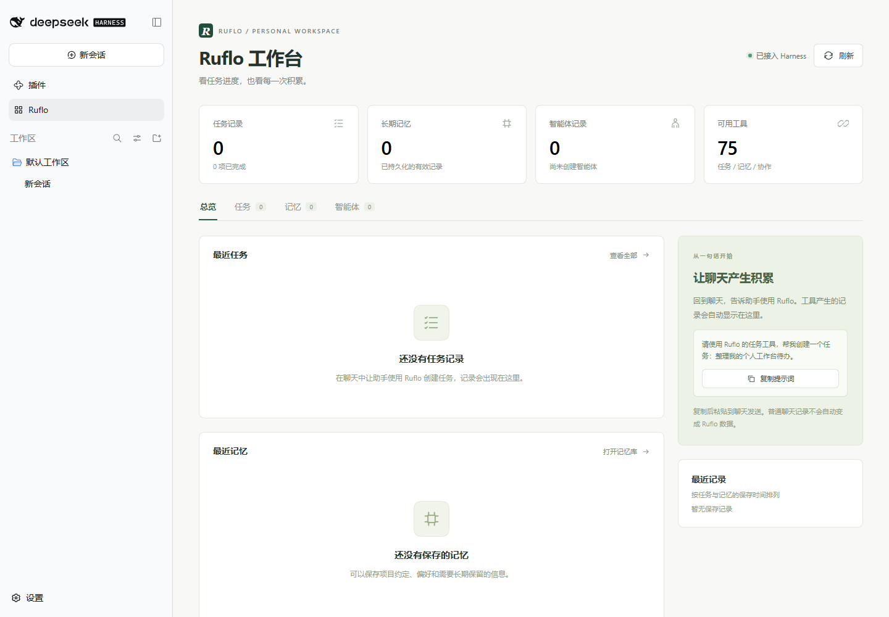

# Ruflo for DeepSeek Harness

在 DeepSeek Harness 左侧栏查看 Ruflo 的任务、长期记忆和智能体记录。

A local Ruflo dashboard and MCP integration for DeepSeek Harness.

[下载安装包](https://github.com/zjun96472-blip/dsh-ruflo-panel/releases/latest) · [安装说明](./INSTALL.md) · [验证记录](./VERIFICATION.md) · [反馈问题](https://github.com/zjun96472-blip/dsh-ruflo-panel/issues)



*截图来自隔离验证环境。首次安装没有预置任务、记忆或智能体；数据由你自己的 Ruflo 工作区产生。*

这是社区插件，包含图形面板与安装脚本，通过 Harness 官方 MCP 客户端连接 Ruflo。无需修改 Harness 核心代码，也可以与其他客户端共用同一 Ruflo 数据目录。本项目不隶属于 DeepSeek 或 Ruflo 官方。

## 可以做什么

- 查看真实任务状态和进度、记忆全文、智能体登记信息。
- 搜索已加载记录、筛选任务状态、查看详情；每 10 秒刷新。
- 通过 Harness 聊天调用 Ruflo 的任务、记忆、协作工具。
- 配置自己的 Ruflo 包路径、工作区、连接名和记忆数据库位置。

面板本身只查看数据。普通聊天不会自动成为 Ruflo 记录，也不会因为安装插件就自动启动智能体。

## 开始使用

需要已经运行过的 **DeepSeek Harness web** 和 **Node.js 24+**。以下命令在 Linux / WSL Ubuntu 中运行。

从 [Releases](https://github.com/zjun96472-blip/dsh-ruflo-panel/releases/latest) 下载 ZIP 或 TGZ，解压后进入目录；也可以克隆指定版本：

```bash
git clone --branch v0.2.0 https://github.com/zjun96472-blip/dsh-ruflo-panel.git
cd dsh-ruflo-panel
```

没有 Ruflo 时，先准备独立运行时：

```bash
sudo apt-get install build-essential python3
node scripts/setup-ruflo.mjs
```

将下面两个示例路径换成自己的 Harness 路径，预览安装：

```bash
node scripts/install.mjs \
  --profile "/path/to/data/profiles/web" \
  --dsh "/path/to/node_modules/@deepseek-ai/dsh/lib/bin.js"
```

核对目录，结束正在运行的任务并停止 Harness，再给同一命令加 `--apply`。安装器会备份并运行离线配置校验。按原方式启动 Harness 后，点击左侧 **Ruflo**。

已有 Ruflo、自定义路径、升级和卸载请见 [INSTALL.md](./INSTALL.md)。软件包不附带个人数据、密钥或第三方可执行程序；运行时由安装脚本下载。

## 兼容范围

| 项目 | 当前验证范围 |
| --- | --- |
| 系统 | Ubuntu 22.04 / WSL2，x64 |
| Node.js | 24.19.0，插件要求 24+ |
| DeepSeek Harness | 0.2.0-rc.2，web profile |
| Ruflo | 3.59.13 |
| 记忆存储 | agentdb-memory.db / memory_entries |

其他 Linux 发行版和软件版本尚未验证；Windows 原生、macOS 和其他架构尚未承诺支持。[compatibility.json](./compatibility.json) 记录验证组合。升级 Ruflo 后需要重新核对存储结构，不兼容时页面会显示错误。

## 数据与登录

接口复用 Harness 的登录 cookie 与 Host/Origin 校验，匿名请求不能读取数据。没有提供任意文件读取或任意工具执行的网页接口。

每类最多加载最近 200 条，搜索针对已加载记录；单条记忆最多显示 16,384 字符。智能体状态是 Ruflo 保存的登记状态，并非进程存活检测。向量检索取决于 Ruflo 的模型和运行时配置，此页面只使用文字筛选。

刚安装且没有记忆数据库时，页面明确显示尚未建立。数据库损坏、结构不兼容和读取失败均显示错误，不会伪装为零条。

## 升级与卸载

用新包再次运行安装器，即可更新由它管理的安装。发现手动修改过的插件或配置内容时会停止，避免覆盖；其他配置修改会保留。

```bash
node scripts/uninstall.mjs --profile "/path/to/data/profiles/web" --apply
```

卸载仅移除管理的配置块，并把插件移至本地备份；Ruflo 运行时、任务、记忆和 Harness 会话均保留。安装和卸载不会自动重启服务，完成后请使用原启动方式重启。

## 许可证与维护

本项目代码采用 [MIT](./LICENSE) 许可证，可使用、修改和再分发，并保留版权与许可声明。DeepSeek Harness、Ruflo 和其依赖适用各自的许可证，见 [第三方说明](./THIRD_PARTY_NOTICES.md)。名称与商标归各自权利人所有。

本项目通过 GitHub 源码与 Release 安装包分发，尚未发布到 npm 或插件市场。开发检查与打包方式见 [CONTRIBUTING.md](./CONTRIBUTING.md)。反馈问题时请提供版本和脱敏后的错误，不要上传 profile、登录 cookie、密钥或任务/记忆数据库。
